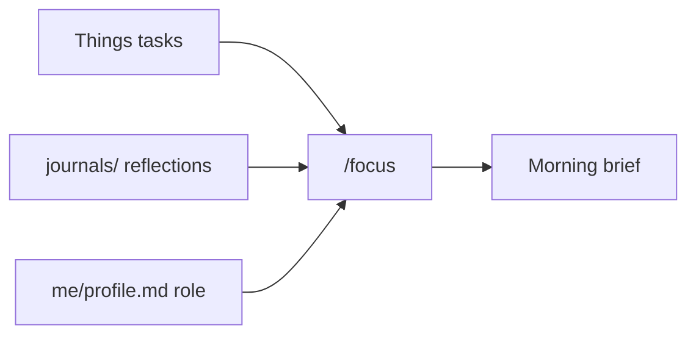

# Dispatch

I used to export my task list from Things and paste it into Claude or Copilot to work out what to do first. Dispatch replaces that routine. It reads my tasks live from Things and my reflections from a daily journal, then writes a three-minute brief that says what to focus on and why. The whole thing runs on Claude Code.

It started with Michael Angeles's [brain](https://github.com/jibbajabba/brain). I liked the idea a lot, but I wanted my tasks to stay in Things, and I didn't want to journal by typing into Claude Code all day. So this is my version, built around Things, Raycast and a brief that judges your tasks against a role you define.

## What it's for

A task list tells you what's on your plate. It doesn't tell you what state you're in, or which task matters most today given the role you're trying to play. Dispatch adds that second read.

It keeps two inputs apart and brings them together once a day. Your tasks live in Things and never leave it. Your journal is a line or two a day about where your head's at. Each morning you run one command, and the brief reads the journal for signal, pulls your live tasks and reorders them against your role. Work and personal are separate contexts with separate roles, so the same command gives you either brief.

## How it works

There are three parts, and each does one job.

**Things holds the tasks.** The brief reads them live through the `things-mcp` server, so there's no export step and no second copy to keep in sync.

**Raycast captures the journal.** A bundled extension opens a text box. You type a thought, press Cmd-Enter, and it's appended to the day's journal file as a markdown list item. Two markers matter: a line starting `→` is a reflection to carry forward, and a line starting `!!` is something you're avoiding.

**Claude Code writes the brief.** The `/focus` command reads your profile, the last week of journal entries and your live tasks. The rules it follows (the brief's structure, the journal conventions and your writing voice) live in `CLAUDE.md`.



## The brief

Five parts, about three minutes to read.

1. **Top three today.** The three tasks that matter most in the active context, judged against your role. Never more than three.
2. **The thing you're avoiding.** Drawn from your profile's growth edges, open threads and any `!!` lines in your journal, and named plainly. If you've committed to something and haven't done it, it comes up every day until you do.
3. **Hard deadlines.** Only tasks with a Things deadline set, shown every day until they pass. A start date isn't a deadline, and the brief won't treat it as one. (It used to, which is how I found out.)
4. **From your journal.** `→` reflections surfaced, `!!` flags folded in, recurring patterns named. Three days without an entry gets noted too, since a missing journal is usually avoidance data.
5. **Sit with this.** One short question from your profile's growth edges to carry through the day. It rotates, so you won't get the same one two days running.

## The daily loop

Through the day, jot things down with the Raycast command as they come up. Mark what's worth carrying with `→` and what you're dodging with `!!`. In the morning, open Claude Code in the repo folder, run `/focus work` (or `personal`, or `all`) and read what comes back.

The journal is what turns a sorted task list into a brief, and it's also the part that takes a habit to build. A single entry does very little. It earns its place after a couple of weeks, when the brief notices you've flagged the same thing four times and says so.

## Commands

`/focus` takes one argument:

- `/focus work` reads your Work area and judges it against your work role.
- `/focus personal` reads your Personal area against your personal role.
- `/focus all` does both, with one shared read of the journal at the top.
- `/focus` on its own defaults to work.

## Structure

```
dispatch/
├── README.md
├── SETUP.md
├── CLAUDE.md                       # the rules: brief structure, journal conventions, voice
├── .mcp.json                       # registers the Things MCP server
├── .gitignore
├── me/
│   └── profile.example.md          # copy to profile.md and fill in (profile.md is gitignored)
├── journals/                       # daily entries, YYYY_MM_DD.md (gitignored)
├── .claude/
│   └── commands/
│       └── focus.md                # the /focus command
└── raycast/
    └── journal-entry/              # the bundled journal-capture extension
        ├── package.json
        ├── tsconfig.json
        ├── README.md
        ├── src/journal-entry.tsx
        └── assets/extension-icon.png
```

## Setup

[SETUP.md](SETUP.md) takes you from installing Claude Code to your first brief. Allow about half an hour the first time.

## Make it yours

The repo ships with my config as a working example. Three things are yours to replace: your roles in `me/profile.md`, the `## My voice` section of `CLAUDE.md`, and the two contexts if work and personal don't match how you split your life. SETUP.md covers each.

You'll need a Mac, because it leans on Things and Raycast. If you don't use Raycast, anything that writes a `- ` line to `journals/YYYY_MM_DD.md` will do. The brief only cares about the files.

## Credit

The file-based, command-driven shape comes from [jibbajabba/brain](https://github.com/jibbajabba/brain) by Michael Angeles. Dispatch swaps the task source for Things and the capture for Raycast, and adds the role-based reprioritisation.

Built with Claude Code.

## License

MIT. If you publish the Raycast extension, change the `author` field in its `package.json` to your own Raycast username first.
